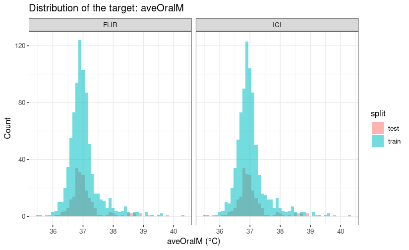
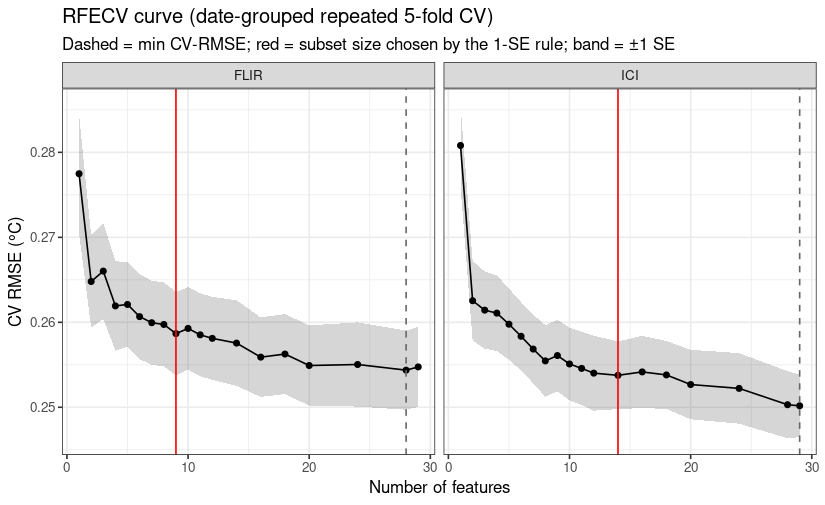
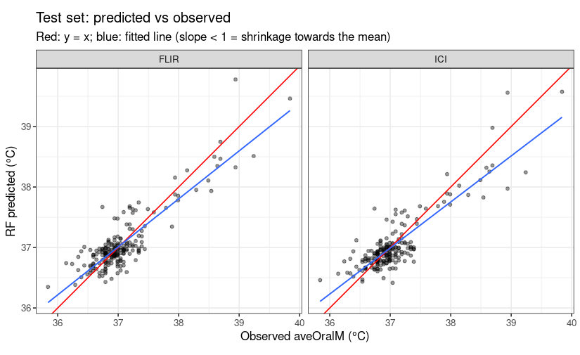
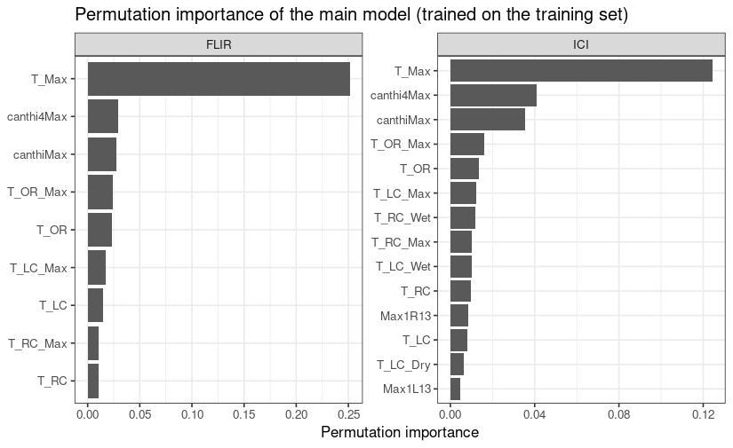

# Predicting oral temperature from infrared measurements


# Introduction

This project aims to predict oral reference temperature from facial
infrared measurements and environmental variables using two regression
approaches: Bayesian hierarchical modelling and random forest
regression. Using data collected with two infrared thermal imaging
devices, FLIR and ICI, we investigate the relationship between these
predictors and oral temperature measured with a reference thermometer.

The two approaches provide different ways of modelling this
relationship. Bayesian hierarchical modelling represents structured
variation through an explicit probabilistic model, whereas random forest
regression can capture nonlinear relationships and interactions through
an ensemble of regression trees. Their predictive performance is
compared on held-out test data using root mean squared error (RMSE) and
mean absolute error (MAE). The comparison examines the strengths and
limitations of each approach for predicting oral temperature.

# Software environment and requirements

All analyses are performed in R using RStudio as the development
environment. For the random forest analysis, `ranger` is used to fit
regression forests and calculate permutation feature importance.

The required packages can be installed using:

``` r
install.packages(c(
  "readr", "dplyr", "tidyr", "ggplot2",
  "caret", "ranger", "doParallel"
))
```

# Data, target and predictors

The source is [Facial and oral temperature data, version
1.0.0](https://physionet.org/content/face-oral-temp-data/1.0.0/), with
version DOI [10.13026/3bhc-9065](https://doi.org/10.13026/3bhc-9065).
The repository provides the dataset under CC0 1.0.

The target is **`aveOralM`**, the average of two oral thermometer
monitor-mode measurements, in degrees Celsius. Monitor mode was
preferred to fast mode because it was more accurate.

| Input group | Variables before four-round aggregation |
|----|----|
| Canthus circles | Max1R13\_, Max1L13\_, aveAllR13\_, aveAllL13\_ |
| Right canthus | T_RC, T_RC_Dry, T_RC_Wet, T_RC_Max |
| Left canthus | T_LC, T_LC_Dry, T_LC_Wet, T_LC_Max |
| Small/extended canthus regions | RCC, LCC, canthiMax, canthi4Max |
| Forehead | T_FHCC, T_FHRC, T_FHLC, T_FHBC, T_FHTC, T_FH_Max, T_FHC_Max |
| Whole face and mouth surface | T_Max, T_OR, T_OR_Max |
| Environmental inputs | T_atm (degrees C), Humidity (%), Distance (m) |

``` r
knitr::opts_chunk$set(
  echo = TRUE, message = FALSE, warning = FALSE,
  fig.path = "figures/", dev = "png", dpi = 110,
  fig.width = 7.5, fig.height = 4.6, out.width = "85%"
)
options(width = 110, dplyr.summarise.inform = FALSE)
invisible(Sys.setlocale("LC_ALL", "C.UTF-8")) 
```

# Random Forest

Setup: load packages, set seed, define global parameters

``` r
library(readr); library(dplyr); library(tidyr); library(ggplot2)
library(caret); library(ranger); library(doParallel)

set.seed(2026)
FAST <- FALSE                       
DATA_DIR <- "data"                  
TRAIN_FRAC <- 0.8                   
TARGET <- "aveOralM"                
OTHER_ORAL <- setdiff(c("aveOralF", "aveOralM"), TARGET)
DROP_ORAL_DISAGREE <- FALSE         
N_CORES  <- 2
registerDoParallel(N_CORES)

K_FOLDS <- 5; N_REPEATS <- if (FAST) 1 else 3
N_TREES_RFE <- if (FAST) 150 else 300   
N_TREES_FINAL <- 1000                   
```

## 1. Read input files

``` r
read_irt <- function(path) {
  read_csv(path, skip = 2, na = c("", "NA"), show_col_types = FALSE,
           name_repair = function(x) ifelse(x == "", paste0("blank", seq_along(x)), x)) |>
    rename_with(~ sub("^T_LC14$", "T_LC4", .x)) |>
    select(-starts_with("blank"))
}

raw <- lapply(c(FLIR = "FLIR", ICI = "ICI"), function(dev) {
  d <- read_irt(file.path(DATA_DIR, paste0(dev, "_groups1and2.csv")))
  stopifnot(!anyDuplicated(d$SubjectID))
  d
})

sapply(raw, \(d) c(rows = nrow(d), cols = ncol(d)))
```

         FLIR  ICI
    rows 1020 1009
    cols  120  120

## 2. Clean Data

``` r
meta_cols <- c("SubjectID", "aveOralF", "aveOralM", "Gender", "Age", "Ethnicity",
               "T_atm", "Humidity", "Distance", "Cosmetics", "Time", "Date")

irt26 <- c("Max1R13", "Max1L13", "aveAllR13", "aveAllL13",
           "T_RC", "T_RC_Dry", "T_RC_Wet", "T_RC_Max", "T_LC", "T_LC_Dry", "T_LC_Wet", "T_LC_Max",
           "RCC", "LCC", "canthiMax", "canthi4Max",
           "T_FHCC", "T_FHRC", "T_FHLC", "T_FHBC", "T_FHTC", "T_FH_Max", "T_FHC_Max",
           "T_Max", "T_OR", "T_OR_Max")
length(irt26)
```

    [1] 26

1.  Line up the readings. It rearranges the table so every row is one
    reading: who, which measurement, which round, and the value.
2.  Throw out impossible readings. A real face is never colder than 30
    °C.
3.  Average what’s left. For each person and each measurement, it takes
    the average of the valid rounds. If all 4 rounds are missing, the
    result stays “missing”.
4.  Count the good rounds. It records how many valid rounds each person
    has

``` r
round_mean <- function(d, min_temp = 30) {
  long <- d |>
    select(SubjectID, all_of(setdiff(names(d), meta_cols))) |>
    pivot_longer(-SubjectID, names_to = c("var", "round"),
                 names_pattern = "^(.*?)_?([1-4])$", values_to = "value")
  stopifnot(is.numeric(long$value), setequal(unique(long$var), c(irt26, "T_offset")))
  
  bad <- long$var != "T_offset" & !is.na(long$value) & long$value < min_temp
  n_bad <- sum(bad)
  long$value[bad] <- NA
  
  wide <- long |>
    group_by(SubjectID, var) |>
    summarise(value = if (all(is.na(value))) NA_real_ else mean(value, na.rm = TRUE), .groups = "drop") |>
    pivot_wider(names_from = var, values_from = value)
  
  n_rounds <- long |> filter(var == "T_Max") |> group_by(SubjectID) |>
    summarise(n_rounds = sum(!is.na(value)))
  list(wide = left_join(wide, n_rounds, by = "SubjectID"), n_bad = n_bad)
}

rm_out <- lapply(raw, round_mean)
sapply(rm_out, \(x) x$n_bad)                  
```

    FLIR  ICI 
      10   24 

``` r
lapply(rm_out, \(x) table(x$wide$n_rounds))   
```

    $FLIR

      2   3   4 
      8  51 961 

    $ICI

      1   2   3   4 
     11  69 258 671 

``` r
clean_subject <- function(d, wide) {
  log <- list()
  m <- d |> select(all_of(meta_cols)) |>
    mutate(Date = as.Date(Date, format = "%y-%m-%d"))
  log$distance_cm_fixed <- sum(m$Distance > 5, na.rm = TRUE)
  m$Distance <- ifelse(m$Distance > 5, m$Distance / 100, m$Distance)
  
  log$humidity_invalid <- sum(m$Humidity > 100, na.rm = TRUE)
  m$Humidity[m$Humidity > 100 & !is.na(m$Humidity)] <- NA
  
  m$target <- m[[TARGET]]
  log$missing_target <- sum(is.na(m$target))
  disagree <- abs(m$aveOralF - m$aveOralM) > 1              
  log$oral_F_M_disagree <- sum(disagree, na.rm = TRUE)
  keep <- !is.na(m$target) & !(DROP_ORAL_DISAGREE & disagree %in% TRUE)
  
  out <- m |> select(-Time, -Age) |> left_join(wide, by = "SubjectID")
  list(data = out[keep, ], log = log, flagged = out[disagree %in% TRUE, c("SubjectID", "aveOralF", "aveOralM")])
}

clean <- Map(clean_subject, raw, lapply(rm_out, `[[`, "wide"))
do.call(rbind, lapply(clean, \(x) as.data.frame(x$log)))      
```

         distance_cm_fixed humidity_invalid missing_target oral_F_M_disagree
    FLIR                 1                0              0                 8
    ICI                  1                1              0                 8

``` r
clean$FLIR$flagged                                           
```

    # A tibble: 8 × 3
      SubjectID aveOralF aveOralM
      <chr>        <dbl>    <dbl>
    1 170206-03     37.6     38.7
    2 170207-02     37.4     38.5
    3 170216-02     37.0     38.0
    4 170216-05     37.4     38.4
    5 170419-05     37.3     38.4
    6 171101-05     37.4     38.7
    7 180214-12     37.2     38.5
    8 180307-07     37.9     38.9

``` r
sapply(clean, \(x) nrow(x$data))
```

    FLIR  ICI 
    1020 1009 

For each device, this step extracts subject-level information (oral
temperature, ambient conditions, demographics) and corrects data-entry
errors: Distance values recorded in centimetres are converted to metres,
and Humidity values above 100% are set to missing. The selected oral
temperature (aveOralM) is stored in a unified target column. Subjects
whose aveOralF and aveOralM differ by more than 1 °C are flagged
(retained by default; they can be excluded via DROP_ORAL_DISAGREE). The
result is merged with the round-averaged facial temperatures by
SubjectID, giving one row per subject for modelling, together with a log
of how many records each cleaning step affected.

``` r
num_feats <- c(irt26, "T_atm", "Humidity", "Distance")
features  <- c(num_feats)
length(features)
```

    [1] 29

``` r
fit_imputer <- function(train) sapply(train[num_feats], median, na.rm = TRUE)
apply_imputer <- function(d, med) {
  for (v in num_feats) d[[v]][is.na(d[[v]])] <- med[[v]]
  d
}

na_tab <- lapply(clean, \(x) colSums(is.na(x$data[features])))
sapply(na_tab, \(v) v[v > 0])
```

    $FLIR
    Distance 
           2 

    $ICI
           RCC        LCC canthi4Max     T_FHCC   Humidity   Distance 
             1          1          1          1          1          2 

## 3. Data split

Subjects from both devices are pooled and randomly split 80/20

``` r
set.seed(2026)
ids <- bind_rows(lapply(clean, \(x) x$data[c("SubjectID", "target")])) |> distinct(SubjectID, .keep_all = TRUE)
train_idx <- caret::createDataPartition(ids$target, p = TRAIN_FRAC, list = FALSE)
split_tbl <- ids |> mutate(split = ifelse(row_number() %in% train_idx, "train", "test")) |> select(SubjectID, split)
write_csv(split_tbl, sprintf("split_train_test_%s.csv", TARGET))

clean <- lapply(clean, \(x) { x$data <- left_join(x$data, split_tbl, by = "SubjectID"); x })
stopifnot(all(sapply(clean, \(x) sum(is.na(x$data$split))) == 0))

bind_rows(lapply(names(clean), \(n) cbind(device = n, clean[[n]]$data))) |>
  group_by(device, split) |>
  summarise(n = n(), mean = mean(target), sd = sd(target), min = min(target), max = max(target),
            n_ge_37.5 = sum(target >= 37.5), n_ge_38 = sum(target >= 38), .groups = "drop")
```

    # A tibble: 4 × 9
      device split     n  mean    sd   min   max n_ge_37.5 n_ge_38
      <chr>  <chr> <int> <dbl> <dbl> <dbl> <dbl>     <int>   <int>
    1 FLIR   test    203  37.1 0.537  35.8  39.8        19      12
    2 FLIR   train   817  37.0 0.503  35.5  40.3        92      37
    3 ICI    test    201  37.1 0.539  35.8  39.8        19      12
    4 ICI    train   808  37.0 0.504  35.5  40.3        92      37

The data of both devices are combined, and histograms of the target
(oral temperature) are drawn separately for the training and test sets

``` r
all_data <- bind_rows(lapply(names(clean), \(n) cbind(device = n, clean[[n]]$data)))
train_data <- filter(all_data, split == "train")

ggplot(all_data, aes(target, fill = split)) +
  geom_histogram(binwidth = 0.1, position = "identity", alpha = .55) +
  facet_wrap(~device) + labs(x = paste(TARGET, "(°C)"), y = "Count", title = paste("Distribution of the target:", TARGET)) + theme_bw()
```



## 4. Model fitting and evaluation

A separate random forest is fitted for each device. RFECV is first used
to select predictors. During cross-validation, all participants measured
on the same date are kept in the same fold. The model is trained on some
dates and validated on the remaining dates.

Next, `mtry` and `min.node.size` are tuned using cross-validation. The
selected predictors and parameters are then used to fit the final model
on the full training set. Its predictions are evaluated on the test set
and compared with an all-feature random forest, a simple linear
regression, and a mean-only baseline.

``` r
# evaluate metric
perf <- function(obs, pred) {
  c(n = length(obs),
    RMSE = sqrt(mean((pred - obs)^2)),
    MAE  = mean(abs(pred - obs)),
    R2   = 1 - sum((obs - pred)^2) / sum((obs - mean(obs))^2),
    Bias = mean(pred - obs),                   
    Within0.3C = mean(abs(pred - obs) <= 0.3),
    Within0.5C = mean(abs(pred - obs) <= 0.5))
}
# bootstrap confidence interval
boot_ci <- function(obs, pred, B = 1000, seed = 1) {
  set.seed(seed); n <- length(obs)
  bs <- replicate(B, { i <- sample.int(n, replace = TRUE); perf(obs[i], pred[i])[c("RMSE", "MAE", "R2")] })
  apply(bs, 1, quantile, c(.025, .975))
}

# Cross-validation division by date
make_group_folds <- function(groups, k = K_FOLDS, reps = N_REPEATS, seed = 1) {
  set.seed(seed); idx <- list()
  for (r in seq_len(reps)) {
    tr <- caret::groupKFold(groups, k = k)
    names(tr) <- sprintf("Fold%d.Rep%d", seq_len(k), r)
    idx <- c(idx, tr)
  }
  list(index = idx, indexOut = lapply(idx, \(i) setdiff(seq_along(groups), i)))
}

# RFECV
make_rfe_funcs <- function(n_res, ntree = 300) {
  list(
    summary = defaultSummary,
    fit  = function(x, y, first, last, ...)
      ranger(x = x, y = y, num.trees = ntree, importance = "permutation",
             respect.unordered.factors = "order", num.threads = 1, seed = 1),
    pred = function(object, x) predict(object, data = x)$predictions,
    rank = function(object, x, y) {                    
      imp <- object$variable.importance
      v <- data.frame(var = names(imp), Overall = as.numeric(imp))
      v[order(v$Overall, decreasing = TRUE), ]
    },
    selectSize = function(x, metric, maximize) {
      best <- which.min(x[, metric])
      thr  <- x[best, metric] + x[best, paste0(metric, "SD")] / sqrt(n_res)
      x[min(which(x[, metric] <= thr)), "Variables"]
    },
    selectVar = function(y, size) {
      s <- y[y$Variables == size, c("var", "Overall")]
      freq <- table(s$var); imp <- tapply(s$Overall, s$var, mean)
      names(imp)[order(-as.numeric(freq[names(imp)]), -imp)][seq_len(size)]
    }
  )
}

run_device <- function(dev, exclude = character(0)) {
  feats <- setdiff(features, exclude)          
  d <- clean[[dev]]$data
  tr <- d |> filter(split == "train"); te <- d |> filter(split == "test")
  
  med <- fit_imputer(tr); tr <- apply_imputer(tr, med); te <- apply_imputer(te, med)
  X_tr <- as.data.frame(tr[feats]); y_tr <- tr$target
  X_te <- as.data.frame(te[feats]); y_te <- te$target
  
  folds <- make_group_folds(tr$Date)
  n_res <- length(folds$index)
  
  ## (1) RFECV
  sizes <- if (FAST) c(1:6, 8, 12, 20, length(feats)) else c(1:12, 14, 16, 18, 20, 24, 28, 32, length(feats))
  sizes <- sort(unique(sizes[sizes <= length(feats)]))
  rfe_fit <- rfe(X_tr, y_tr, sizes = sizes, metric = "RMSE", maximize = FALSE,
                 rfeControl = rfeControl(functions = make_rfe_funcs(n_res, N_TREES_RFE),
                                         method = "cv", index = folds$index, indexOut = folds$indexOut,
                                         rerank = TRUE, saveDetails = TRUE, returnResamp = "all",
                                         allowParallel = TRUE, verbose = FALSE))
  sel <- predictors(rfe_fit)
  
  p <- length(sel)
  grid <- expand.grid(mtry = sort(unique(pmax(1, round(c(.25, .5, .75, 1) * p)))),
                      splitrule = "variance", min.node.size = c(3, 5, 10, 20))
  tune <- train(x = X_tr[sel], y = y_tr, method = "ranger", metric = "RMSE", tuneGrid = grid,
                trControl = trainControl(method = "cv", index = folds$index[1:K_FOLDS],
                                         indexOut = folds$indexOut[1:K_FOLDS]),
                num.trees = if (FAST) 300 else 500, respect.unordered.factors = "order",
                importance = "permutation", seed = 1)
  best <- tune$bestTune

  fit_sel <- ranger(x = X_tr[sel], y = y_tr, num.trees = N_TREES_FINAL, mtry = best$mtry,
                    min.node.size = best$min.node.size, importance = "permutation",
                    respect.unordered.factors = "order", num.threads = N_CORES, seed = 1)

  fit_all <- ranger(x = X_tr, y = y_tr, num.trees = N_TREES_FINAL, mtry = floor(length(feats) / 3),
                    min.node.size = 5, importance = "permutation",
                    respect.unordered.factors = "order", num.threads = N_CORES, seed = 1)

  lm_base <- lm(target ~ canthiMax, data = tr)
  
  pred <- data.frame(SubjectID = te$SubjectID, Date = te$Date, obs = y_te,
                     RF_selected = predict(fit_sel, data = X_te[sel])$predictions,
                     RF_all      = predict(fit_all, data = X_te)$predictions,
                     LM_canthiMax = predict(lm_base, te),
                     Mean_only   = mean(y_tr))
  
  list(dev = dev, exclude = exclude, train = tr, test = te, features_sel = sel, rfe = rfe_fit, tune = tune, best = best,
       fit_sel = fit_sel, fit_all = fit_all, pred = pred, n_res = n_res, median_imputer = med)
}
```

``` r
t0 <- Sys.time()
res <- list(FLIR = run_device("FLIR"), ICI = run_device("ICI"))
round(difftime(Sys.time(), t0, units = "mins"), 1)
```

    Time difference of 2.4 mins

The cross-validated RMSE and its standard error at each feature-subset
size from RFECV are collected for both devices and plotted against the
number of features.

``` r
rfe_curve <- bind_rows(lapply(res, \(r) {
  cbind(device = r$dev, r$rfe$results[, c("Variables", "RMSE", "RMSESD")],
        se = r$rfe$results$RMSESD / sqrt(r$n_res),
        best_size = r$rfe$results$Variables[which.min(r$rfe$results$RMSE)],
        chosen_size = length(r$features_sel))
}))

ggplot(rfe_curve, aes(Variables, RMSE)) +
  geom_ribbon(aes(ymin = RMSE - se, ymax = RMSE + se), alpha = .2) +
  geom_line() + geom_point(size = 1.5) +
  geom_vline(aes(xintercept = best_size), linetype = 2, colour = "grey40") +
  geom_vline(aes(xintercept = chosen_size), colour = "red") +
  facet_wrap(~device) +
  labs(x = "Number of features", y = "CV RMSE (°C)",
       title = "RFECV curve (date-grouped repeated 5-fold CV)",
       subtitle = "Dashed = min CV-RMSE; red = subset size chosen by the 1-SE rule; band = ±1 SE") +
  theme_bw()
```



``` r
rfe_curve |> distinct(device, best_size, chosen_size)
```

      device best_size chosen_size
    1   FLIR        28           9
    2    ICI        29          14

The features selected by RFECV

``` r
sel_tab <- bind_rows(lapply(res, \(r) {
  k <- length(r$features_sel)
  freq <- r$rfe$variables |> filter(Variables == k) |> count(var, name = "n_folds") |>
    mutate(stability = n_folds / r$n_res)
  data.frame(device = r$dev, rank = seq_len(k), feature = r$features_sel) |>
    left_join(freq, by = c("feature" = "var")) |> select(device, rank, feature, stability)
}))
sel_tab
```

       device rank    feature stability
    1    FLIR    1      T_Max 1.0000000
    2    FLIR    2 canthi4Max 1.0000000
    3    FLIR    3  canthiMax 1.0000000
    4    FLIR    4   T_OR_Max 1.0000000
    5    FLIR    5       T_OR 1.0000000
    6    FLIR    6   T_LC_Max 0.8666667
    7    FLIR    7       T_LC 0.8666667
    8    FLIR    8   T_RC_Max 0.5333333
    9    FLIR    9       T_RC 0.4666667
    10    ICI    1      T_Max 1.0000000
    11    ICI    2 canthi4Max 1.0000000
    12    ICI    3  canthiMax 1.0000000
    13    ICI    4   T_LC_Max 1.0000000
    14    ICI    5       T_OR 1.0000000
    15    ICI    6   T_OR_Max 1.0000000
    16    ICI    7   T_RC_Max 1.0000000
    17    ICI    8       T_LC 1.0000000
    18    ICI    9       T_RC 1.0000000
    19    ICI   10   T_RC_Wet 1.0000000
    20    ICI   11   T_LC_Dry 1.0000000
    21    ICI   12    Max1R13 0.9333333
    22    ICI   13   T_LC_Wet 0.8000000
    23    ICI   14    Max1L13 0.6000000

Features shared across devices

``` r
Reduce(intersect, lapply(res, `[[`, "features_sel"))
```

    [1] "T_Max"      "canthi4Max" "canthiMax"  "T_OR_Max"   "T_OR"       "T_LC_Max"   "T_LC"       "T_RC_Max"  
    [9] "T_RC"      

The top five hyperparameter combinations (mtry, min.node.size), ranked
by cross-validated RMSE

``` r
lapply(res, \(r) r$tune$results |> arrange(RMSE) |> head(5) |>
         select(mtry, min.node.size, RMSE, RMSESD, Rsquared))
```

    $FLIR
      mtry min.node.size      RMSE     RMSESD  Rsquared
    1    7             3 0.2579208 0.02915158 0.7369672
    2    9             3 0.2581364 0.02867189 0.7365359
    3    9             5 0.2581907 0.02835057 0.7366665
    4    7             5 0.2583957 0.02863135 0.7363924
    5    9            10 0.2585477 0.02816416 0.7363953

    $ICI
      mtry min.node.size      RMSE     RMSESD  Rsquared
    1    7            10 0.2537011 0.02720321 0.7437962
    2    4             3 0.2537403 0.02532685 0.7426992
    3    4             5 0.2538598 0.02574356 0.7425685
    4    4            10 0.2538744 0.02738393 0.7431161
    5    7             3 0.2539089 0.02520086 0.7427230

On the test set, RMSE, MAE, R², bias, and the proportion of subjects
with errors within ±0.3 °C and ±0.5 °C are computed for four models per
device (the RFECV-selected random forest, a random forest on all
features, a canthiMax linear-regression baseline, and a mean-only
baseline) and summarised in one performance table, used to evaluate the
models and compare them with other models.

``` r
models <- c("RF_selected", "RF_all", "LM_canthiMax", "Mean_only")
perf_tab <- bind_rows(lapply(res, \(r) {
  bind_rows(lapply(models, \(m) data.frame(device = r$dev, model = m, t(perf(r$pred$obs, r$pred[[m]])))))
}))
perf_tab |> mutate(across(c(RMSE, MAE, R2, Bias), \(x) round(x, 3)),
                   across(starts_with("Within"), \(x) round(100 * x, 1)))
```

      device        model   n  RMSE   MAE     R2   Bias Within0.3C Within0.5C
    1   FLIR  RF_selected 203 0.260 0.201  0.764 -0.001       79.3       93.6
    2   FLIR       RF_all 203 0.265 0.196  0.756 -0.016       78.8       92.1
    3   FLIR LM_canthiMax 203 0.344 0.269  0.589 -0.020       63.5       88.2
    4   FLIR    Mean_only 203 0.537 0.332 -0.003 -0.030       68.0       85.2
    5    ICI  RF_selected 201 0.266 0.198  0.756 -0.021       78.6       93.5
    6    ICI       RF_all 201 0.266 0.193  0.756 -0.025       80.1       93.5
    7    ICI LM_canthiMax 201 0.340 0.259  0.601 -0.018       68.2       87.1
    8    ICI    Mean_only 201 0.539 0.333 -0.002 -0.027       68.2       85.1

For the main model’s test-set predictions, 95% confidence intervals for
RMSE, MAE and R² are estimated with 1000 bootstrap resamples and
tabulated together with the point estimates

``` r
bind_rows(lapply(res, \(r) {
  ci <- boot_ci(r$pred$obs, r$pred$RF_selected)
  data.frame(device = r$dev, metric = colnames(ci),
             lower = unname(ci[1, ]), upper = unname(ci[2, ]),
             est = unname(perf(r$pred$obs, r$pred$RF_selected)[colnames(ci)]))
})) |> mutate(across(where(is.numeric), \(x) round(x, 3)))
```

      device metric lower upper   est
    1   FLIR   RMSE 0.230 0.290 0.260
    2   FLIR    MAE 0.179 0.225 0.201
    3   FLIR     R2 0.650 0.835 0.764
    4    ICI   RMSE 0.228 0.302 0.266
    5    ICI    MAE 0.174 0.224 0.198
    6    ICI     R2 0.643 0.828 0.756

the main model’s predictions are plotted against the observed oral
temperatures for each device, with the y = x reference line and a fitted
linear trend line overlaid. This gives a visual check of prediction
accuracy, systematic bias, and the degree of shrinkage towards the mean.

``` r
pred_long <- bind_rows(lapply(res, \(r) cbind(device = r$dev, r$pred)))

ggplot(pred_long, aes(obs, RF_selected)) +
  geom_point(alpha = .4, size = 1.2) + geom_abline(slope = 1, intercept = 0, colour = "red") +
  geom_smooth(method = "lm", se = FALSE, linewidth = .6) +
  facet_wrap(~device) + coord_equal() +
  labs(x = paste("Observed", TARGET, "(°C)"), y = "RF predicted (°C)",
       title = "Test set: predicted vs observed", subtitle = "Red: y = x; blue: fitted line (slope < 1 = shrinkage towards the mean)") + theme_bw()
```



``` r
pred_long |>
  mutate(stratum = ifelse(obs >= 37.5, ">= 37.5 C (fever range)", "< 37.5 C")) |>
  group_by(device, stratum) |>
  summarise(n = n(), RMSE = sqrt(mean((RF_selected - obs)^2)), MAE = mean(abs(RF_selected - obs)),
            Bias = mean(RF_selected - obs), .groups = "drop") |>
  mutate(across(c(RMSE, MAE, Bias), \(x) round(x, 3)))
```

    # A tibble: 4 × 6
      device stratum                     n  RMSE   MAE   Bias
      <chr>  <chr>                   <int> <dbl> <dbl>  <dbl>
    1 FLIR   < 37.5 C                  184 0.242 0.189  0.018
    2 FLIR   >= 37.5 C (fever range)    19 0.396 0.316 -0.185
    3 ICI    < 37.5 C                  182 0.238 0.182  0.001
    4 ICI    >= 37.5 C (fever range)    19 0.45  0.356 -0.226

features’ importance

``` r
imp <- bind_rows(lapply(res, \(r) {
  v <- r$fit_sel$variable.importance
  data.frame(device = r$dev, feature = names(v), importance = as.numeric(v))
}))
imp <- imp |> mutate(key = reorder(paste(device, feature, sep = "___"), importance))   
ggplot(imp, aes(key, importance)) +
  geom_col() + coord_flip() + facet_wrap(~device, scales = "free") +
  scale_x_discrete(labels = \(x) sub("^.*___", "", x)) +
  labs(x = NULL, y = "Permutation importance", title = "Permutation importance of the main model (trained on the training set)") + theme_bw()
```



# Bayesian hierarchical modelling

# Reproducibility

This section records the computing environment used to generate this
report. All random processes were seeded (`set.seed(2026)` for the
train/test split and resampling folds; `seed = 1` for `ranger`), and
package versions are locked in `renv.lock`. To reproduce the results,
run `renv::restore()` in the project root, then re-render this document.

``` r
sessionInfo()
```

    R version 4.5.3 (2026-03-11)
    Platform: x86_64-pc-linux-gnu
    Running under: Ubuntu 22.04.5 LTS

    Matrix products: default
    BLAS:   /usr/lib/x86_64-linux-gnu/blas/libblas.so.3.10.0 
    LAPACK: /usr/lib/x86_64-linux-gnu/lapack/liblapack.so.3.10.0  LAPACK version 3.10.0

    locale:
     [1] LC_CTYPE=C.UTF-8       LC_NUMERIC=C           LC_TIME=C.UTF-8        LC_COLLATE=C.UTF-8    
     [5] LC_MONETARY=C.UTF-8    LC_MESSAGES=C.UTF-8    LC_PAPER=C.UTF-8       LC_NAME=C             
     [9] LC_ADDRESS=C           LC_TELEPHONE=C         LC_MEASUREMENT=C.UTF-8 LC_IDENTIFICATION=C   

    time zone: Europe/Berlin
    tzcode source: system (glibc)

    attached base packages:
    [1] parallel  stats     graphics  grDevices datasets  utils     methods   base     

    other attached packages:
     [1] doParallel_1.0.17 iterators_1.0.14  foreach_1.5.2     ranger_0.18.0     caret_7.0-1      
     [6] lattice_0.20-45   ggplot2_4.0.2     tidyr_1.3.2       dplyr_1.2.1       readr_2.2.0      

    loaded via a namespace (and not attached):
     [1] tidyselect_1.2.1     timeDate_4052.112    farver_2.1.2         S7_0.2.1-1           fastmap_1.2.0       
     [6] pROC_1.19.0.1        digest_0.6.39        rpart_4.1.16         timechange_0.4.0     lifecycle_1.0.5     
    [11] survival_3.2-13      magrittr_2.0.5       compiler_4.5.3       rlang_1.2.0          tools_4.5.3         
    [16] utf8_1.2.6           yaml_2.3.12          data.table_1.18.2.1  knitr_1.51           labeling_0.4.3      
    [21] bit_4.6.0            plyr_1.8.9           RColorBrewer_1.1-3   withr_3.0.2          purrr_1.2.2         
    [26] nnet_7.3-17          grid_4.5.3           stats4_4.5.3         e1071_1.7-17         future_1.70.0       
    [31] globals_0.19.1       scales_1.4.0         MASS_7.3-55          cli_3.6.6            rmarkdown_2.31      
    [36] crayon_1.5.3         generics_0.1.4       future.apply_1.20.2  reshape2_1.4.5       tzdb_0.5.0          
    [41] proxy_0.4-29         stringr_1.6.0        splines_4.5.3        BiocManager_1.30.27  vctrs_0.7.3         
    [46] hardhat_1.4.3        Matrix_1.7-5         jsonlite_2.0.0       hms_1.1.4            bit64_4.6.0-1       
    [51] listenv_0.10.1       gower_1.0.2          recipes_1.3.2        glue_1.8.0           parallelly_1.47.0   
    [56] codetools_0.2-18     lubridate_1.9.5      stringi_1.8.7        gtable_0.3.6         tibble_3.3.1        
    [61] pillar_1.11.1        htmltools_0.5.9      ipred_0.9-15         lava_1.9.0           R6_2.6.1            
    [66] vroom_1.7.1          evaluate_1.0.5       renv_1.3.1           class_7.3-20         Rcpp_1.1.1-1        
    [71] nlme_3.1-155         prodlim_2026.03.11   mgcv_1.8-39          xfun_0.57            pkgconfig_2.0.3     
    [76] ModelMetrics_1.2.2.2

**Package versions.** Package versions are locked in `renv.lock`
(managed with the `renv` package). To recreate the same environment:

1.  Open the project folder in R (set it as the working directory).
2.  Run `renv::restore()` to install the recorded package versions.
3.  Place the PhysioNet data files in the `data/` folder (see the Data
    section for the download link).
4.  Re-render this document (`quarto render workflow.qmd`).
